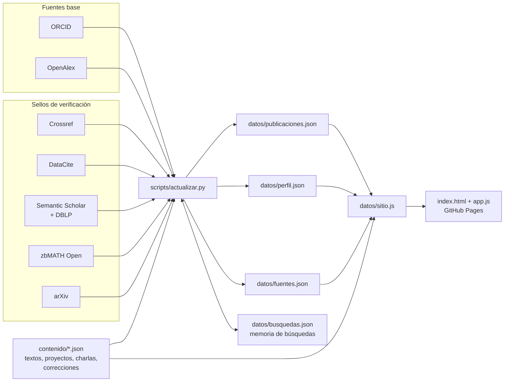

# Modelo de datos: el perfil de una persona

- **Tarea:** 6.1 de la carta Gantt (semana 4)
- **Fecha:** 2026-11-17
- **Estado:** vigente para el piloto. Los cambios se registran en [decisiones/](decisiones/).

Este documento describe qué datos guarda el sitio, en qué archivo está cada uno y **de qué fuente sale cada campo**. Es la base del esquema genérico de "perfil de una persona" que se reutilizaría si el piloto pasa a ser un producto.

## 1. Idea general

El sitio no tiene base de datos ni servidor. Todo el perfil vive en archivos JSON dentro del repositorio, separados en dos carpetas según **quién los escribe**:

| Carpeta | Quién la escribe | Qué contiene | Se edita a mano |
|---|---|---|---|
| `contenido/` | La persona (por formulario) o el desarrollador; desde la semana 6, también la IA | Textos, áreas, proyectos, charlas, escritos, correcciones | Sí |
| `datos/` | El recolector `scripts/actualizar.py`, cada lunes en GitHub Actions | Publicaciones, cifras, coautores, afiliaciones, estado de las fuentes | **No**: se regenera completa |

El recolector une ambas carpetas en un solo archivo, `datos/sitio.js`, que es lo único que lee la página.



## 2. Convenciones

- **Textos bilingües:** todo texto visible que no viene de una fuente es una lista `[inglés, español]`. Ejemplo: `"t": ["Researcher", "Investigador"]`.
- **Fechas:** ISO `AAAA-MM-DD`. Cada archivo de `datos/` lleva `generado` (fecha de la recolección) y cada archivo de `contenido/` lleva `actualizado`.
- **Notas internas:** las claves que empiezan con `_` (`_nota`, `_nota_titulos`) explican el archivo y la página las ignora.
- **Claves cortas:** se usan nombres de una o dos letras (`t`, `y`, `c`…) para que `sitio.js` pese poco. Su significado está en las tablas de abajo.
- **Identificadores:** una obra se identifica por su DOI en minúsculas. Si no tiene DOI, por `oa:<id OpenAlex>` o `orcid:<put-code>`. Ese `id` es el que usan las correcciones y las líneas confirmadas, así que **no debe cambiar** entre semanas.
- **Áreas y subáreas:** el contenido se asigna a una subárea con la forma `perfil.subarea` (p. ej. `research.cot`). `also` la muestra además en otras subáreas, pero solo si la persona lo decide; nunca es automático.

## 3. Datos generados (`datos/`)

### 3.1 `publicaciones.json`: la lista unificada de obras

```json
{ "generado": "2026-11-17", "obras": [ { ... }, ... ] }
```

| Campo | Significado | Fuente |
|---|---|---|
| `id` | Identificador estable de la obra (ver convenciones) | DOI de OpenAlex u ORCID |
| `t` | Título | OpenAlex; si solo está en ORCID, ORCID |
| `y` | Año de publicación | OpenAlex; si no, ORCID |
| `c` | Citas | OpenAlex (`cited_by_count`). `null` si la obra no está en OpenAlex |
| `v` | Revista, libro o congreso | OpenAlex (`primary_location.source`); si no, ORCID (`journal-title`) |
| `vtipo` | Tipo de fuente: `journal`, `repository`, `conference`, `book series`… | OpenAlex |
| `ty` | Tipo de obra: `article`, `book-chapter`, `preprint`… | OpenAlex; si no, ORCID |
| `doi` | DOI en minúsculas, sin `https://doi.org/` | OpenAlex u ORCID |
| `au` | Autores, en orden | OpenAlex |
| `n` | Número de autores | Calculado |
| `temas` | Hasta 3 temas | OpenAlex (`topics`) |
| `oa` | ID de la obra en OpenAlex (`W…`) | OpenAlex |
| `fuentes` | Fuentes base que la traen: `openalex`, `orcid` o ambas | Calculado al unir |
| `recuperada` | `"doi"` o `"titulo"`: la obra estaba solo en ORCID y se encontró en OpenAlex sin vínculo al perfil (tarea 2.2) | Calculado |
| `linea` | Línea de investigación (`cot`, `qc`, `found`…) | Reglas de `contenido/lineas.json` o decisión de la persona |
| `linea_estado` | `sugerida` (por reglas) o `confirmada` (por la persona) | Calculado |
| `oculta` | `true` si la persona decidió no mostrarla | `contenido/lineas.json` |
| `vf` | Sellos de verificación: un objeto por fuente que confirmó la obra (ver 3.2) | Crossref, DataCite, Semantic Scholar, zbMATH, arXiv, DBLP |

Cómo se arma la lista, en orden:

1. Se descargan las obras de OpenAlex vinculadas al perfil del autor. Se descartan erratas, retractaciones, paratextos y los tipos de `tipos_excluidos`. Los duplicados dentro de OpenAlex se unen por DOI o por título + año, y se queda la versión con DOI de editorial y más citas.
2. Se agregan las obras de ORCID. Si una ya está (por DOI, título + año ±1, o título con y sin subtítulo), solo se marca `orcid` en `fuentes`. Si no está, entra como "solo ORCID", sin citas.
3. **Recuperación (tarea 2.2):** cada obra solo-ORCID se busca en OpenAlex por DOI o título, y se acepta solo si la persona figura entre los autores. Si ya estaba en la lista era un duplicado y se une; si no, se completa con citas, autores y temas. Ver [decisión 0006](decisiones/0006-recuperar-citas-sin-sumarlas-al-perfil.md).
4. Se quitan las obras de `obras_excluidas` y se asigna la línea.
5. Se agregan los sellos de verificación.

### 3.2 Sellos de verificación (`vf`)

Cada sello indica que una fuente independiente confirma que la obra existe. Solo se guarda lo mínimo para mostrarlo y compararlo:

| Sello | Contenido | Cómo se consulta |
|---|---|---|
| `crossref` | `{"venue": revista oficial}` | Por DOI |
| `datacite` | `{"pub": editor}` | Por DOI, si Crossref no lo tiene (DOI de repositorios como Zenodo o arXiv) |
| `s2` | `{"venue", "cites"}`: revista y citas según Semantic Scholar | DOI en lote; título si no hay DOI |
| `dblp` | `{"id"}` | Viene dentro de la respuesta de Semantic Scholar |
| `zbmath` | `{"id"}` | Por DOI, recordado en `busquedas.json` (ver 3.5) |
| `arxiv` | `{"id"}` | Lo que informan OpenAlex o Semantic Scholar; si no, búsqueda por título exacto en arXiv, recordada en `busquedas.json` (ver 3.5) |

Si una fuente falla, se conservan sus sellos de la semana anterior y `datos/fuentes.json` lo indica.

### 3.3 `perfil.json`: cifras y trayectoria

| Campo | Significado | Fuente |
|---|---|---|
| `stats.works` | Obras visibles en la lista unificada | Calculado |
| `stats.cites`, `stats.h`, `stats.i10` | Citas e índices **del perfil de OpenAlex**, tal cual | OpenAlex (`authors`) |
| `stats.works_openalex` | Obras vinculadas al perfil en OpenAlex | OpenAlex |
| `stats.cites_recuperadas` | Citas de las obras recuperadas. **No se suman** a `cites` | Calculado (tarea 2.2) |
| `por_anio` | `[año, n.º de obras]` | Calculado de las obras visibles |
| `coautores` | Los 10 coautores más frecuentes: `[nombre, n.º de obras]` | OpenAlex (autores de cada obra) |
| `afiliaciones` | Instituciones con `id`, nombre `n`, `ciudad`, `pais`, coordenadas `ll`, `ror`, años `anios` y tipo `k` (`aff`) | OpenAlex (`authors.affiliations` + `institutions`), con las correcciones de `afiliaciones_*` |
| `orcid` | Cuántos registros hay en cada sección de ORCID y el detalle de empleos y formación | ORCID |

### 3.4 `fuentes.json`: estado de cada fuente

```json
{ "generado": "2026-11-17",
  "estado": { "openalex": { "estado": "ok", "fecha": "2026-11-17", "resultado": 84, "cites": 967, "h": 20 }, ... } }
```

Una entrada por fuente (`orcid`, `openalex`, `crossref`, `datacite`, `s2`, `dblp`, `zbmath`, `arxiv`) y por proceso (`recuperacion`). `estado` es `ok` o `error`; `resultado` es el número de registros o el mensaje de error. La página de Fuentes del sitio lee este archivo.

### 3.5 `busquedas.json`: memoria de las búsquedas lentas

```json
{ "generado": "2026-11-19",
  "arxiv":  { "10.1234/abc": { "fecha": "2026-11-18", "id": null }, ... },
  "zbmath": { "10.1234/abc": { "fecha": "2026-11-19", "id": "1234.56789" }, ... } }
```

Dos fuentes de sellos son lentas: zbMATH tarda unos 7 s por DOI y arXiv pide 3 s entre consultas. Sin memoria, la actualización semanal tardaba unos 14 minutos, casi todo en zbMATH. Para cada obra se guarda la `fecha` de su última búsqueda en cada fuente y el `id` encontrado (`null` si no se encontró). Solo lo usa el recolector; **no entra en `sitio.js`**.

- Cada semana se buscan las obras que nunca se buscaron y, de las demás, las 8 con la búsqueda más antigua, si tiene al menos 28 días (`REVISAR_POR_SEMANA` y `REVISAR_DIAS` en el script). Así cada obra se vuelve a revisar más o menos cada dos meses, por si zbMATH la indexa o se sube una versión a arXiv.
- Las obras que no se buscan esa semana usan el resultado guardado.
- En arXiv no se busca por título lo que ya trae un ID de arXiv desde OpenAlex o Semantic Scholar.
- Se olvidan las obras que salen de la lista.

## 4. Contenido editable (`contenido/`)

| Archivo | Qué guarda | Campos principales | Origen hoy | Origen previsto |
|---|---|---|---|---|
| `perfil.json` | Nombre, título, rol, afiliaciones visibles, biografía, correo, fotos del carrusel | `bio`, `fotos[{src, d, lugar}]` | Escrito a mano a partir del sitio anterior | Biografía con IA (semana 6) |
| `perfiles.json` | Las áreas de la persona (hasta 3 + la principal) y sus subáreas | `t` título, `r` rol, `sub` resumen, `subs[{id, t, d}]` | A mano | Textos con IA (semana 6) |
| `proyectos.json` | Proyectos y fondos | `k` tipo, `t`, `o` organización, `y`, `st` estado (`on` vigente, `done` terminado), `s` subárea, `also`, `d` | A mano (ORCID no tiene fondos) | ORCID + búsqueda web (semana 8) |
| `eventos.json` | Charlas, talleres y residencias | `when`, `y`, `kind`, `title`, `place`, `s`, `also`, `d` | A mano | Búsqueda web (semanas 7–8) |
| `premios.json` | Premios y nombramientos | `y`, `t`, `o`, `ll` | A mano (ORCID no tiene distinciones) | ORCID + búsqueda web |
| `lugares.json` | Residencias y eventos para el mapa | `n`, `c` ciudad, `ll`, `y`, `k` (`ev` = evento o residencia) | A mano | Búsqueda web |
| `escritos.json` | Ensayos, revista y videos | `k`, `t`, `y`, `s`, `u` enlace, `d` | A mano | RSS de Medium y API de YouTube (semana 9) |
| `oportunidades.json` | Sección «Trabaja conmigo» | `t`, `d`, `s` | A mano | Textos con IA |
| `lineas.json` | Reglas para sugerir la línea de cada obra, líneas confirmadas y obras ocultas | `reglas[[línea, regex, flags]]`, `confirmadas{id: línea}`, `ocultas[id]` | A mano | Decisiones de la persona |
| `correcciones.json` | Lo que se corrige de las fuentes (ver 5) | ver 5 | A mano | Decisiones de la persona |
| `fuentes.json` | Texto de la página de Fuentes: qué aporta cada fuente y cómo se consulta | `fuentes[{n, st, what, how, id}]`, `pasos`, `reglas_sellos` | A mano | Fijo |

## 5. Correcciones: corregir sin inventar

`contenido/correcciones.json` es el único lugar donde se modifica lo que traen las fuentes, y solo permite **quitar, unir o renombrar**, nunca agregar datos:

| Clave | Para qué |
|---|---|
| `tipos_excluidos` | Tipos de obra que no se muestran (erratas, revisiones, números de revista…) |
| `obras_excluidas` | IDs de obras que no son de la persona o que no quiere mostrar |
| `titulos_excluidos` | Expresión regular para títulos que no son obras propias (prefacios, correcciones…) |
| `afiliaciones_unir` | Une dos IDs de institución de OpenAlex que son la misma (p. ej. UTEM duplicada) |
| `afiliaciones_excluir` | Instituciones que no se muestran |
| `afiliaciones_nombres` | Nombre a mostrar para una institución |

## 6. Hacia un esquema genérico

El piloto guarda los datos de una sola persona, con claves cortas y algunos valores fijos en el código (ORCID e ID de OpenAlex en `actualizar.py`). Para un producto con varias personas, lo previsto es:

- Mover los identificadores (`ORCID`, `OPENALEX_AUTHOR`) a `contenido/perfil.json` o a un archivo de configuración por persona.
- Mantener la separación `contenido/` (lo que decide la persona) y `datos/` (lo que se recolecta).
- Agregar a cada dato de `contenido/` su procedencia (`fuente`: `formulario`, `ia`, `busqueda_web` con la URL y el texto que lo respalda), como ya tienen las obras con `fuentes` y `vf`.
- Las licencias de cada fuente para uso comercial están en el documento de alcance (sección 4).
